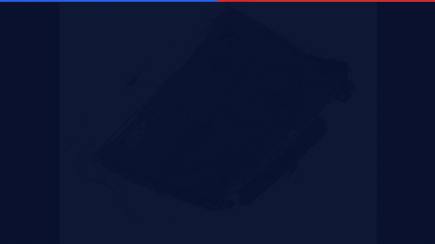
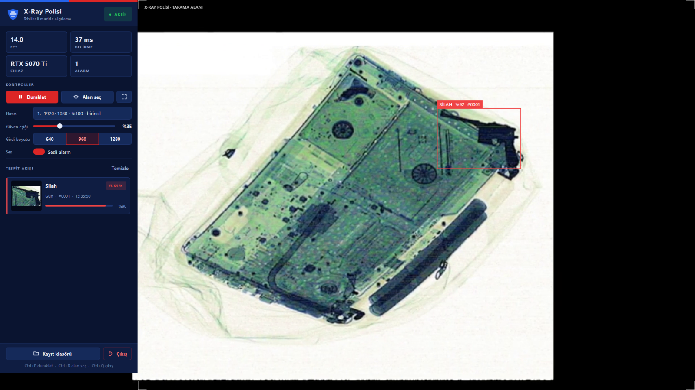
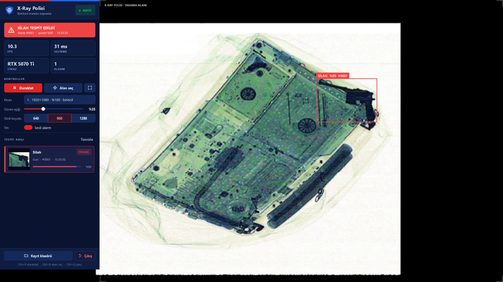
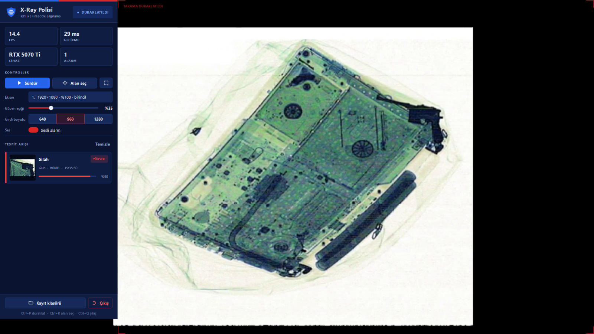
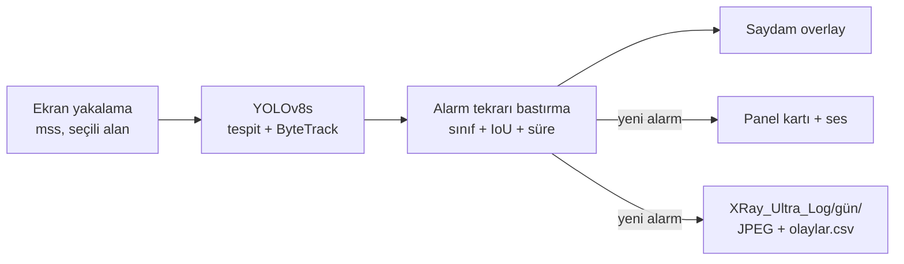

# X-Ray Polisi — Tehlikeli madde algılama

[](https://github.com/rose-omer/X-RAY-Tehlikeli-Madde-Algilama/actions/workflows/ci.yml)


[](LICENSE)

X-Ray Polisi, X-ray cihazının ekranını okur ve tehlikeli nesneleri gerçek zamanlı işaretler.
Cihaza ya da yazılımına entegrasyon gerekmez; sonuç ekranın üstüne saydam bir katman olarak çizilir.
Her yeni tespit panele düşer ve kırpılmış görüntüsüyle kanıt arşivine yazılır.

> **English summary.** X-Ray Polisi is a desktop app that captures an X-ray scanner's screen,
> runs a YOLOv8s model (12 threat classes, mAP50 0.94) and draws boxes on a transparent overlay.
> It tracks objects so one item raises one alarm, keeps a JPEG + CSV evidence log, plays a sound
> on high-severity hits and handles multi-monitor and Windows DPI scaling. No scanner integration.

## Proje hakkında

Bu proje bir ekip çalışmasıdır. Model ve ilk sürüm [Ahmet Koç](https://github.com/ahmetkc58)
tarafından geliştirildi ([kaynak repo](https://github.com/ahmetkc58/X-RAY-Tehlikeli-Madde-Algilama)).
Sürüm 2 aynı modeli kullanır; hataları giderir ve arayüzü baştan tasarlar.

## Tanıtım



Sesli tam sürüm: [docs/tanitim.mp4](docs/tanitim.mp4) (20 sn, 1080p).

## Ekran görüntüleri

Görüntüler uygulamanın kendisinden alındı. X-ray kareleri ilk sürümün demo videosundandır.

| | |
|---|---|
| <br>Silah tespiti | <br>Yüksek önemli alarm |
| <br>Tarama duraklatıldı | <br>Tarama alanı seçimi |

## Ne yapar?

- **12 sınıf:** Silah, Mermi, Bıçak, Cop, Kelepçe, Makas, Çekiç, Sprey, Çakmak, İngiliz anahtarı, Pense, Powerbank.
- **Önem derecesi:** yüksek (kırmızı), orta (turuncu), düşük (mavi). Kutu, kart ve alarm rengi buna göre değişir; yüksek alarmda siren şeridi yanıp söner.
- **Tek nesne, tek alarm:** takipçi nesneyi kaybedip yeni ID verse de aynı nesne yeniden alarm üretmez.
- **Tarama alanı seçimi:** yalnız X-ray görüntüsü taranır; diğer pencereler yanlış alarm üretmez.
- **Kanıt arşivi:** gün klasörlerine JPEG ve `olaylar.csv` (Excel'de açılır). Karta tıklayınca kanıt açılır.
- **Sesli alarm:** yüksek ve orta önemli tespitte.
- **Çoklu ekran ve DPI:** ekran seçilir; Windows ölçeği (%125, %150) doğru hesaplanır.

## Mimari



- Yakalama ve model ayrı iş parçacığında koşar; arayüz donmaz.
- Overlay ve panel Windows yakalamasından gizlenir (`WDA_EXCLUDEFROMCAPTURE`). Çizilen kutular bir sonraki karede modele girmez.
- Ekran okunamazsa (kilit ekranı, UAC) uygulama çökmez; artan aralıklarla yeniden dener ve panelde **HATA** gösterir.

## Model

| | |
|---|---|
| Mimari | YOLOv8s (Ultralytics) |
| Eğitim | 50 epoch, 640 px, Kaggle (`yolov8s.pt` üzerinden ince ayar) |
| Doğrulama | mAP50 **0.942** · mAP50-95 **0.804** · precision 0.946 · recall 0.888 |
| Dosya | `best.pt` |
| Hız (1280 px) | RTX 5070 Ti ~22 ms/kare · CPU ~350 ms/kare |

Yeniden eğitmek için: `python train.py --data veri.yaml`

## Hızlı başlangıç

Gereken: Windows 10 2004 ya da üstü, Python 3.10–3.12.

```powershell
git clone https://github.com/rose-omer/X-RAY-Tehlikeli-Madde-Algilama.git
cd X-RAY-Tehlikeli-Madde-Algilama
py -3.12 -m venv .venv
.\.venv\Scripts\Activate.ps1
python -m pip install --upgrade pip
```

GPU varsa önce CUDA'lı PyTorch'u kurun (yoksa bu adımı atlayın):

```powershell
# RTX 50 serisi (Blackwell) ve güncel kartlar: CUDA 12.8
pip install torch torchvision --index-url https://download.pytorch.org/whl/cu128
```

Sonra diğer bağımlılıklar ve çalıştırma:

```powershell
pip install -r requirements.txt
python xray-detect.py
```

1. Panel ekranın soluna yerleşir. Model yüklenince durum **AKTİF** olur.
2. **Alan seç** ile yalnız X-ray görüntüsünü çizin. Yanındaki düğme tüm ekrana döner.
3. Tespitler ekranda kutu, panelde kart olarak görünür.

| Kısayol | İş |
|---|---|
| `Ctrl+P` | Duraklat / sürdür |
| `Ctrl+R` | Tarama alanı seç |
| `Ctrl+Q` | Çıkış |

Panelden değişen ayarlar (ekran, güven eşiği, girdi boyutu, ses) bir sonraki açılışta hatırlanır.

## Ayarlar

[`xray_polisi/config.py`](xray_polisi/config.py) içindeki sabitler:

| Sabit | Varsayılan | Açıklama |
|---|---|---|
| `MODEL_PATH` | `best.pt` | Ağırlık dosyası |
| `CONF_THRESHOLD` | `0.35` | Düşük değer daha çok tespit, daha çok yanlış alarm |
| `IMG_SIZE` | `1280` | Model 640 ile eğitildi; 1280 küçük nesnede daha çok buluyor ama daha yavaş |
| `DEDUP_IOU` / `DEDUP_TTL_S` | `0.3` / `10` | Aynı nesne sayılma örtüşmesi ve unutma süresi |
| `PANEL_WIDTH` | `380` | Panel genişliği (mantıksal px) |
| `PANEL_SIDE` | `left` | Panelin yeri: `left` ya da `right` |
| `MAX_FEED_ITEMS` | `150` | Panelde tutulan en çok kart |
| `LOG_DIR` | `XRay_Ultra_Log` | Kanıt klasörü |

Demo videosu çekerken overlay'in kayda girmesi için: `$env:XRAY_POLISI_SHOW_IN_CAPTURE = "1"`. Bu modda model de kutuları görür; yalnız tanıtım için kullanın.

## Testler

```powershell
python -m pytest
```

Koordinat dönüşümü (DPI), alarm tekrarı bastırma, kırpma, CSV günlüğü ve Türkçe büyük harf için birim testleri.

## Proje yapısı

```
├── xray-detect.py          # Başlatıcı
├── xray_polisi/
│   ├── config.py           # Ayarlar, sınıf adları ve önem dereceleri
│   ├── logic.py            # Saf mantık: DPI eşleme, alarm tekrarı, kayıt yolu, CSV
│   ├── worker.py           # Yakalama + model döngüsü (QThread)
│   ├── winapi.py           # Yakalamadan gizleme, sistem sesi
│   ├── app.py              # Pencereleri ve iş parçacığını bağlar
│   └── ui/                 # Panel, overlay, alan seçici, tema, simgeler
├── tests/                  # pytest
├── train.py                # Eğitim betiği
├── best.pt                 # Eğitilmiş ağırlık
└── docs/                   # Tanıtım videosu ve ekran görüntüleri
```

## Sorun giderme

- **Kutular gecikiyor / FPS düşük:** panelden girdi boyutunu 960 ya da 640 yapın; GPU kurun.
- **Çok yanlış alarm:** güven eşiğini %50 civarına çıkarın; **Alan seç** ile yalnız X-ray görüntüsünü tarayın.
- **Panel HATA gösteriyor:** ekran kilitli ya da UAC açık olabilir; uygulama kendiliğinden yeniden dener. Ayrıntı: `XRay_Ultra_Log/xray_polisi.log`.

## Sınırlamalar

Bu proje bir **karar destek ve araştırma prototipidir**; güvenlik görevlisinin yerine geçmez. Tespit kalitesi eğitim verisindeki nesne türleri, görüntü rengi ve cihaz tipiyle sınırlıdır. Gerçek kullanımdan önce kendi cihaz görüntülerinizle doğrulayın.

İlk sürümün demosu: [GIF](assets/demo.gif) · [MP4](model_%C3%A7%C4%B1kt%C4%B1s%C4%B1.mp4)

## Lisans

MIT. Ayrıntı: [LICENSE](LICENSE).
