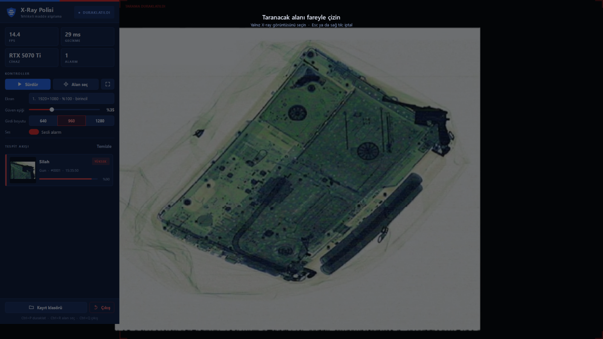

# X-Ray Polisi

[](https://github.com/rose-omer/X-RAY-Tehlikeli-Madde-Algilama/actions/workflows/ci.yml)

X-ray cihazının ekranını okuyup bagajdaki tehlikeli nesneleri işaretleyen bir masaüstü uygulaması.
YOLOv8 ile 12 sınıf tanır: silah, mermi, bıçak, cop, kelepçe, makas, çekiç, sprey, çakmak, İngiliz anahtarı,
pense ve powerbank. Cihaza bağlanmaz; ekranın üstüne saydam bir katman çizer.

Ekip projesi. 
([ilk repo](https://github.com/ahmetkc58/X-RAY-Tehlikeli-Madde-Algilama)).

## Tanıtım


Sesli hâli: [docs/tanitim.mp4](docs/tanitim.mp4)

## Ekran görüntüleri

Görüntüler uygulamanın kendisinden alındı. X-ray kareleri ilk sürümün demo videosundan.

| Silah tespiti | Alarm |
|---|---|
|  |  |

| Duraklatıldı | Tarama alanı seçimi |
|---|---|
|  |  |

## Kullanım

1. `python xray-detect.py` ile açın. Panel ekranın solunda açılır; model yüklenince durum AKTİF olur.
2. **Alan seç** ile yalnız X-ray görüntüsünü çizin. Yanındaki düğme taramayı tüm ekrana geri alır.
3. Bulunan nesne ekranda kutuyla, panelde kartla görünür. Silah, mermi ve bıçakta ses çalar, üstteki siren şeridi yanıp söner.
4. Karta tıklayınca kanıt görüntüsü açılır. Kayıtlar `XRay_Ultra_Log/<tarih>/` klasöründe, `olaylar.csv` ile birlikte durur.

| Kısayol | İşlev |
|---|---|
| Ctrl+P | Duraklat / sürdür |
| Ctrl+R | Tarama alanı seç |
| Ctrl+Q | Çıkış |

Panelde değişen ayarlar (ekran, güven eşiği, girdi boyutu, ses) bir sonraki açılışta hatırlanır.

## Nasıl çalışır

1. **Yakala**: seçili alan [mss](https://github.com/BoboTiG/python-mss) ile saniyede yaklaşık 16 kez okunur.
   Uygulamanın kendi pencereleri yakalamaya girmez, yani çizilen kutular modele geri dönmez.
2. **Tanı**: YOLOv8s her kareyi 1280 px'te inceler; ByteTrack nesneleri kareler boyunca izler.
3. **Tekrarı ele**: takip kimliği değişse de aynı sınıftaki ve aynı yerdeki nesne 10 sn içinde ikinci alarm vermez.
4. **Göster ve kaydet**: overlay kutuyu çizer; yeni nesne panele düşer, kırpılmış görüntüsü diske yazılır.

Yakalama ve model ayrı iş parçacığında çalışır, arayüz donmaz. Ekran okunamazsa (kilit ekranı, UAC) uygulama
kapanmaz, panelde HATA yazar ve yeniden dener. Windows ölçeği (%125, %150) ve birden çok ekran desteklenir.

Model 50 epoch, 640 px ile Kaggle'da eğitildi. Doğrulamada mAP50 0.942, mAP50-95 0.804. RTX 5070 Ti'de kare
başına yaklaşık 22 ms, CPU'da 350 ms sürer. Yeniden eğitmek için: `python train.py --data veri.yaml`.

## Kurulum

1. Python 3.10, 3.11 ya da 3.12 kurun. Windows 10 (2004) ya da üstü gerekir.
2. Sanal ortamı açın:
   ```powershell
   py -3.12 -m venv .venv
   .venv\Scripts\activate
   ```
3. NVIDIA kart varsa önce CUDA'lı PyTorch'u kurun (RTX 50 serisi için `cu128`). Kart yoksa bu adımı atlayın.
   ```powershell
   pip install torch torchvision --index-url https://download.pytorch.org/whl/cu128
   ```
4. Diğer paketleri kurup uygulamayı başlatın:
   ```powershell
   pip install -r requirements.txt
   python xray-detect.py
   ```

Model yolu, panel genişliği ve yeri (`PANEL_SIDE`), alarm tekrar süresi ve kayıt klasörü
`xray_polisi/config.py` dosyasının başındaki sabitlerdedir.

Tanıtım videosu çekerken overlay'in kayda girmesi için `XRAY_POLISI_SHOW_IN_CAPTURE=1` verin.
Bu kipte model de kutuları görür; yalnız çekim için kullanın.

## Dosyalar

| Dosya | Görev |
|---|---|
| `xray-detect.py` | Başlatıcı |
| `xray_polisi/app.py` | Pencereleri ve iş parçacığını bağlar |
| `xray_polisi/worker.py` | Ekran yakalama ve model döngüsü |
| `xray_polisi/logic.py` | Ekran ölçeği hesabı, alarm tekrarı, kayıt yolu, CSV |
| `xray_polisi/config.py` | Ayarlar, sınıf adları, önem dereceleri |
| `xray_polisi/winapi.py` | Pencereleri yakalamadan gizleme, sistem sesi |
| `xray_polisi/ui/` | Panel, overlay, alan seçici, tema |
| `train.py` | Eğitim betiği |
| `best.pt` | Eğitilmiş model |
| `docs/` | Tanıtım videosu ve ekran görüntüleri |
| `tests/` | Testler: `python -m pytest` |

Bu bir araştırma projesidir; güvenlik görevlisinin yerine geçmez. İlk sürümün demosu:
[GIF](assets/demo.gif), [MP4](model_%C3%A7%C4%B1kt%C4%B1s%C4%B1.mp4).

## Lisans

MIT. Ayrıntı: [LICENSE](LICENSE).
