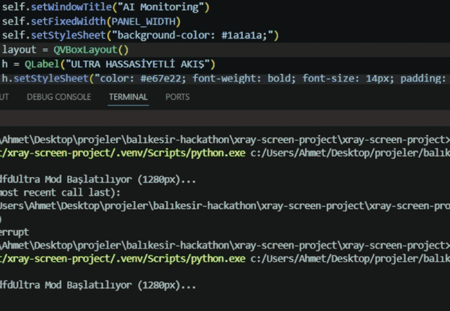
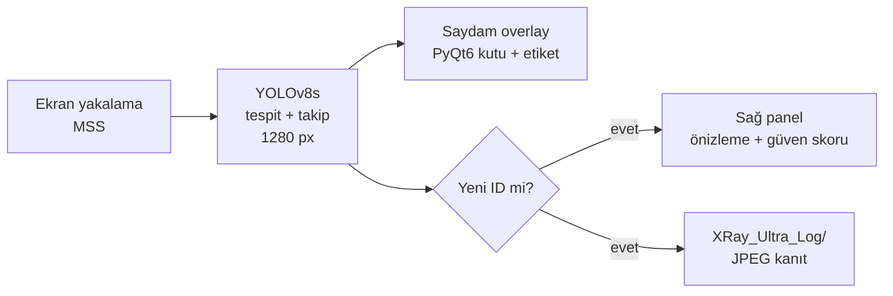

<div align="center">

# 🛡️ SecurAI — X-Ray Otonom Tehdit Algılama

**X-ray tarama görüntülerindeki tehlikeli nesneleri gerçek zamanlı tespit eden, takip eden ve kayıt altına alan masaüstü uygulaması.**




<sub>Canlı demo: model, bagaj görüntüsündeki nesneleri tespit edip her birine takip kimliği (ID) atıyor. <a href="model_%C3%A7%C4%B1kt%C4%B1s%C4%B1.mp4">Tam videoyu (MP4, sesli) indir</a></sub>

</div>

---

## Ne yapar?

Bir x-ray cihazının ekran görüntüsü başka bir yazılımda ya da donanımda açık olsa bile SecurAI ekranı doğrudan yakalar, YOLOv8 ile analiz eder ve sonucu **ekranın üstüne saydam bir katman** olarak çizer. Cihaza ya da yazılıma entegrasyon gerekmez.

- 🎯 **12 tehlikeli nesne sınıfı** tespit eder
- 🔁 **Nesne takibi:** aynı nesne kareler boyunca tek ID ile izlenir, aynı nesne için tekrar alarm üretilmez
- 🗂️ **Canlı kayıt paneli:** yeni bir nesne görüldüğü anda kırpılmış görüntüsü, güven skoru ve saatiyle sağ panele düşer
- 💾 **Kanıt arşivi:** her yeni tespit `XRay_Ultra_Log/` klasörüne JPEG olarak kaydedilir
- 🔍 **Yüksek çözünürlüklü analiz:** küçük ve üst üste binmiş nesneler için 1280 px girdi boyutu
- 🖥️ **Çoklu ekran / DPI uyumu:** Windows ölçeklendirmesi (%125, %150) için koordinat düzeltmesi

### Tespit edilen sınıflar

| | | | |
|---|---|---|---|
| 🔫 Gun | 🔪 Knife | ✂️ Scissors | 🔨 Hammer |
| 🔧 Wrench | 🗜️ Plier | 🏏 Baton | ⛓️ HandCuffs |
| 🔋 Powerbank | 💥 Bullet | 🧴 Sprayer | 🔥 Lighter |

## Nasıl çalışır?



Her ~60 ms'de bir kare alınır (yaklaşık 16 FPS hedefi). Sağ panel işleme alanının dışında tutulur, böylece panelin kendisi modele girmez.

## Model

| | |
|---|---|
| Mimari | YOLOv8s (Ultralytics) |
| Sınıf sayısı | 12 |
| Eğitim | 50 epoch, Kaggle ortamı (`yolov8s.pt` üzerinden fine-tune) |
| Çıkarım girdi boyutu | 1280 px |
| Güven eşiği | 0.35 (`CONF_THRESHOLD`) |
| Dosyalar | `best.pt` (en iyi ağırlık), `last.pt` (son epoch) |

## Kurulum

```powershell
git clone https://github.com/ahmetkc58/X-RAY-Tehlikeli-Madde-Algilama.git
cd X-RAY-Tehlikeli-Madde-Algilama

python -m venv .venv
.venv\Scripts\Activate.ps1
python -m pip install --upgrade pip
pip install -r requirements.txt
```

## Çalıştırma

```powershell
python xray-detect.py
```

İlk açılışta model yüklenirken 20-30 saniye beklemek normaldir. Uygulama ana monitörü yakalar. Tarama görüntüsünü bu monitörde açık tutman yeterlidir.

### Ayarlar

[`xray-detect.py`](xray-detect.py) dosyasının başındaki sabitlerle değiştirilir:

| Sabit | Varsayılan | Açıklama |
|---|---|---|
| `MODEL_PATH` | `best.pt` | Kullanılacak ağırlık dosyası |
| `CONF_THRESHOLD` | `0.35` | Düşük değer daha çok tespit, daha çok yanlış alarm |
| `IMG_SIZE` | `1280` | Yüksek değer küçük nesnelerde daha iyi, ama daha yavaş |
| `LOG_FOLDER` | `XRay_Ultra_Log` | Kırpılmış tespit görüntülerinin kaydedileceği klasör |
| `PANEL_WIDTH` | `360` | Sağ panel genişliği (px) |

### GPU (opsiyonel)

NVIDIA GPU varsa CUDA destekli PyTorch kurmak hızı belirgin şekilde artırır. CUDA 12.1 için:

```powershell
pip install --upgrade --index-url https://download.pytorch.org/whl/cu121 torch torchvision
python -c "import torch; print(torch.cuda.is_available(), torch.version.cuda)"
```

## Sorun giderme

- **NumPy 2.x uyumsuzluğu:** `pip install "numpy<2"`
- **Kutular gecikiyor / FPS düşük:** `IMG_SIZE` değerini 960 veya 640'a indir, ya da GPU kur.
- **Çok fazla yanlış alarm:** `CONF_THRESHOLD` değerini 0.5 civarına çıkar.

## Proje yapısı

```
├── xray-detect.py        # Ana uygulama (yakalama, tespit, overlay, panel)
├── best.pt / last.pt     # Eğitilmiş YOLOv8s ağırlıkları
├── requirements.txt
├── model_çıktısı.mp4     # Tam demo videosu
└── assets/               # README görselleri
```

## Sınırlamalar

Bu proje bir **karar destek ve araştırma prototipidir**. Güvenlik operatörünün yerine geçmez. Tespit kalitesi eğitim verisinin kapsadığı nesne türleri, görüntü rengi ve cihaz tipiyle sınırlıdır. Gerçek operasyonel kullanımdan önce kendi cihaz görüntülerinle ayrıca doğrulanmalıdır.

## Lisans

MIT. Detay için [LICENSE](LICENSE).

---

<div align="center">

Geliştirici: **Ahmet Koç** · [GitHub](https://github.com/ahmetkc58) · [LinkedIn](https://linkedin.com/in/ahmetkoc) · [kocengineer.com](https://kocengineer.com)

</div>
