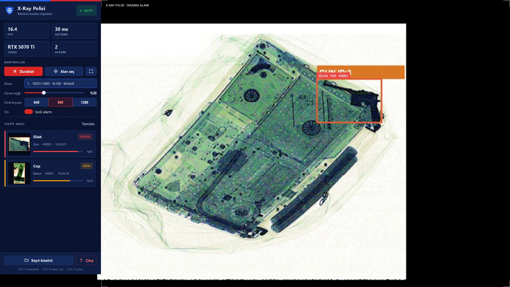
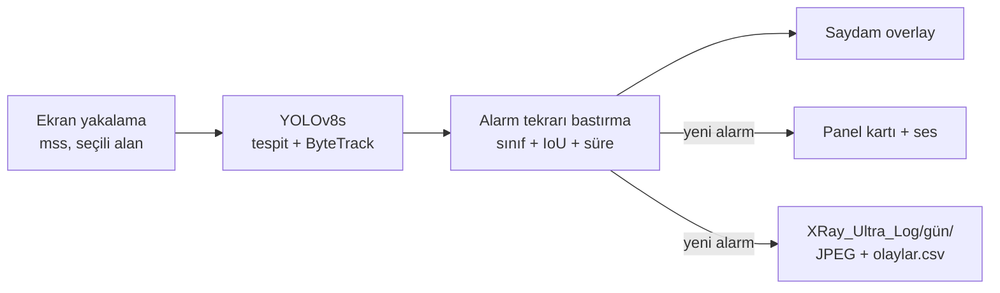

<div align="center">

# 🚔 X-Ray Polisi — Tehlikeli Madde Algılama

**X-ray tarama ekranındaki tehlikeli nesneleri gerçek zamanlı bulan, takip eden ve kanıtıyla kaydeden masaüstü uygulaması.**




<sub>Panel solda; tarama alanındaki silah kırmızı çerçeve ve etiketle işaretli. İlk sürümün demosu: <a href="assets/demo.gif">GIF</a> · <a href="model_%C3%A7%C4%B1kt%C4%B1s%C4%B1.mp4">MP4</a></sub>

</div>

---

## Ne yapar?

X-ray cihazının görüntüsü başka bir yazılımda açık olsa bile X-Ray Polisi ekranı yakalar, YOLOv8 ile analiz eder ve sonucu ekranın üstüne saydam bir katman olarak çizer. Cihaza ya da yazılıma entegrasyon gerekmez.

- 🎯 **12 sınıf:** Silah, Mermi, Bıçak, Cop, Kelepçe, Makas, Çekiç, Sprey, Çakmak, İngiliz anahtarı, Pense, Powerbank.
- 🚦 **Önem derecesi:** yüksek (kırmızı), orta (turuncu), düşük (mavi). Kutu, kart ve alarm rengi buna göre değişir; yüksek alarmda siren şeridi yanıp söner.
- 🚔 **Polis merkezi teması:** lacivert zemin, siren mavisi ve alarm kırmızısı.
- 🔁 **Tek nesne, tek alarm:** takipçi nesneyi kaybedip yeni ID verse de aynı nesne yeniden alarm üretmez.
- ⌖ **Tarama alanı seçimi:** yalnız X-ray görüntüsünü tarar; diğer pencereler yanlış alarm üretmez.
- 🗂️ **Canlı akış:** her yeni tespit kırpılmış görüntü, güven skoru ve saatle panele düşer. Karta tıklayınca kanıt açılır.
- 💾 **Kanıt arşivi:** gün klasörlerine JPEG + `olaylar.csv` (Excel'de açılır).
- 🔊 **Sesli alarm:** yüksek ve orta önemli tespitte.
- 🖥️ **Çoklu ekran ve DPI:** ekran seçilebilir; Windows ölçeği (%125, %150) doğru hesaplanır.

## Nasıl çalışır?



- Yakalama ve model ayrı iş parçacığında koşar; arayüz donmaz.
- Overlay ve panel Windows yakalamasından gizlenir (`WDA_EXCLUDEFROMCAPTURE`). Böylece çizilen kutular bir sonraki karede modele girmez.
- Ekran okunamazsa (kilit ekranı, UAC) uygulama çökmez; artan aralıklarla yeniden dener ve panelde **HATA** gösterir.

## Model

| | |
|---|---|
| Mimari | YOLOv8s (Ultralytics) |
| Eğitim | 50 epoch, 640 px, Kaggle (`yolov8s.pt` üzerinden ince ayar) |
| Doğrulama | mAP50 **0.942** · mAP50-95 **0.804** · precision 0.946 · recall 0.888 |
| Dosya | `best.pt` |
| Hız (1280 px) | RTX 5070 Ti ~22 ms/kare · CPU ~350 ms/kare |

Yeniden eğitmek için: `python train.py --data veri.yaml`

## Kurulum

```powershell
git clone https://github.com/rose-omer/X-RAY-Tehlikeli-Madde-Algilama.git
cd X-RAY-Tehlikeli-Madde-Algilama
py -3.12 -m venv .venv
.\.venv\Scripts\Activate.ps1
python -m pip install --upgrade pip
```

GPU varsa önce CUDA'lı PyTorch'u kurun (yoksa bu adımı atlayın):

```powershell
# RTX 50 serisi (Blackwell) ve güncel kartlar: CUDA 12.8
pip install torch torchvision --index-url https://download.pytorch.org/whl/cu128
```

Sonra diğer bağımlılıklar:

```powershell
pip install -r requirements.txt
python -c "import torch; print(torch.cuda.is_available())"
```

## Çalıştırma

```powershell
python xray-detect.py
```

1. Panel ekranın soluna yerleşir. Model yüklenince durum **AKTİF** olur.
2. **Alan seç** ile yalnız X-ray görüntüsünü çizin. **⛶** tüm ekrana döner.
3. Tespitler ekranda kutu, panelde kart olarak görünür.

| Kısayol | İş |
|---|---|
| `Ctrl+P` | Duraklat / sürdür |
| `Ctrl+R` | Tarama alanı seç |
| `Ctrl+Q` | Çıkış |

Panelden değişen ayarlar (ekran, güven eşiği, girdi boyutu, ses) bir sonraki açılışta hatırlanır.

### Ayarlar

[`xray_polisi/config.py`](xray_polisi/config.py) içindeki sabitler:

| Sabit | Varsayılan | Açıklama |
|---|---|---|
| `MODEL_PATH` | `best.pt` | Ağırlık dosyası |
| `CONF_THRESHOLD` | `0.35` | Düşük değer daha çok tespit, daha çok yanlış alarm |
| `IMG_SIZE` | `1280` | Model 640 ile eğitildi; 1280 küçük nesnede daha çok buluyor ama daha yavaş |
| `DEDUP_IOU` / `DEDUP_TTL_S` | `0.3` / `10` | Aynı nesne sayılma örtüşmesi ve unutma süresi |
| `PANEL_WIDTH` | `380` | Panel genişliği (mantıksal px) |
| `PANEL_SIDE` | `left` | Panelin yeri: `left` ya da `right` |
| `MAX_FEED_ITEMS` | `150` | Panelde tutulan en çok kart |
| `LOG_DIR` | `XRay_Ultra_Log` | Kanıt klasörü |

Demo videosu çekerken overlay'in kayda girmesi için: `$env:XRAY_POLISI_SHOW_IN_CAPTURE = "1"`. Bu modda model de kutuları görür; yalnız tanıtım için kullanın.

## Testler

```powershell
python -m pytest
```

Koordinat dönüşümü (DPI), alarm tekrarı bastırma, kırpma ve CSV günlüğü için birim testleri.

## Proje yapısı

```
├── xray-detect.py          # Başlatıcı
├── xray_polisi/
│   ├── config.py           # Ayarlar, sınıf adları ve önem dereceleri
│   ├── logic.py            # Saf mantık: DPI eşleme, alarm tekrarı, kayıt yolu, CSV
│   ├── worker.py           # Yakalama + model döngüsü (QThread)
│   ├── winapi.py           # Yakalamadan gizleme, sistem sesi
│   ├── app.py              # Pencereleri ve iş parçacığını bağlar
│   └── ui/                 # Panel, overlay, alan seçici, tema, simgeler
├── tests/                  # pytest
├── train.py                # Eğitim betiği
├── best.pt                 # Eğitilmiş ağırlık
└── assets/                 # README görselleri
```

## Sorun giderme

- **Kutular gecikiyor / FPS düşük:** panelden girdi boyutunu 960 ya da 640 yapın; GPU kurun.
- **Çok yanlış alarm:** güven eşiğini %50 civarına çıkarın; **Alan seç** ile yalnız X-ray görüntüsünü tarayın.
- **Panel HATA gösteriyor:** ekran kilitli ya da UAC açık olabilir; uygulama kendiliğinden yeniden dener. Ayrıntı: `XRay_Ultra_Log/xray_polisi.log`.
- **Overlay kayda giriyor:** Windows 10 2004 ve üstü gerekir.

## Sınırlamalar

Bu proje bir **karar destek ve araştırma prototipidir**; güvenlik görevlisinin yerine geçmez. Tespit kalitesi eğitim verisindeki nesne türleri, görüntü rengi ve cihaz tipiyle sınırlıdır. Gerçek kullanımdan önce kendi cihaz görüntülerinizle doğrulayın.

## Lisans

MIT. Ayrıntı: [LICENSE](LICENSE).

---

<div align="center">

Ekip projesi · Model ve ilk sürüm: [Ahmet Koç](https://github.com/ahmetkc58) ([kaynak repo](https://github.com/ahmetkc58/X-RAY-Tehlikeli-Madde-Algilama)) · Arayüz ve 2.0 sürümü: [rose-omer](https://github.com/rose-omer)

</div>
